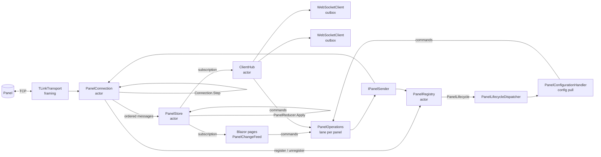

# Architecture

How NeoHub is put together, the rules every change follows, and how the suite proves it.

NeoHub talks to a DSC PowerSeries Neo panel over ITv2 (TLink) and serves its state to a web
UI and to WebSocket clients (Home Assistant, Homebridge). Everything that used to share mutable
state across threads now does one of two things:

- **Pure functions over immutable data** (the *core*): the protocol state machine, the panel
  state reducer, the settings rules. No I/O, no clock, no threads.
- **Single-reader actors** (the *shell*): each owns its state, takes its inputs from one
  `Channel<T>`, and handles them one at a time. Nothing else touches that state.

There are no locks. Readers that need state without waiting read an immutable snapshot that its
owner publishes.

## Why

On 2026-11-17 a switch firmware update dropped the panel's TCP connection. The panel reconnected
within seconds, but NeoHub refused the new connection while the dead one was still registered,
and the alarm was unreachable for about two hours. Fixing that led to an audit of every thread
that touched shared state (PR #4): 24 races and missing timeouts. PR #4 patched them with locks,
and its own tests then failed on 2-core CI runners. That was a sign that behavior still depended
on thread scheduling. This design removes the shared state instead of guarding it.

## Data flow



1. **Bytes in.** `TLinkTransport` splits the TCP stream into frames. A malformed frame is
   reported and skipped, and garbage with no delimiter is dropped after 16 KB.
2. **Protocol.** `PanelConnection` decrypts each frame and feeds it to
   `Connection.Step(state, input) → (state, effects)`. That pure state machine holds the
   handshake, the sequence numbers, acks, reply matching, readiness, command deadlines and the
   heartbeat. The actor then performs the effects in order: write a frame, complete a request,
   publish a notification, or close.
3. **State.** Each connection hands its messages, in arrival order, to `PanelStore` through
   `IPanelMessageSink`: started, then each message, then ended. The store applies them with
   `PanelReducer.Apply(state, event) → (state, changes)`, publishes the new snapshot, and passes
   the changes to every subscriber.
4. **Out.** Pages subscribe through `PanelChangeFeed`. `ClientHub` subscribes once and fans
   changes out to each WebSocket client's own outbox.
5. **Commands.** The UI, WebSocket clients and the configuration pull call services. Anything that
   needs the panel's single programming-mode slot runs as one operation on that panel's lane in
   `PanelOperations`. Messages go out through `IPanelSender`, which finds the live connection in
   the registry.

## The core (pure)

| Function | File | Decides |
|---|---|---|
| `Connection.Step` | `TLink/ITv2/Protocol/Connection.cs` | Everything about one ITv2 connection. Inputs: `FrameReceived`, `CredentialsResolved`, `SendRequested`, `CancelRequested`, `Tick`, `TransportClosed`, `CloseRequested`. Effects: `WriteFrame`, `ResolveCredentials`, `CompleteRequest`, `Publish`, `SessionEstablished`, `SessionReady`, `CloseConnection`, `Diagnostic`. Time comes in as data on each input. |
| `ITv2Crypto` | `TLink/ITv2/Encryption/ITv2Crypto.cs` | Type 1 / Type 2 key derivation and AES-128-ECB, as functions of key bytes. |
| `PanelReducer.Apply` | `NeoHub/Domain/PanelReducer.cs` | Panel state from events: live notifications, pulled status, configuration, user list, connection lifecycle. |
| `PanelReadings` | `NeoHub/Domain/PanelReadings.cs` | Panel replies turned into readings (partition status, zone status, installer setup). |
| `ConnectionSettingsRules` | `NeoHub/Services/ConnectionSettingsProvider.cs` | Which credentials a handshake should try, and how the settings change when a new panel appears. |
| `WebSocketMessages` | `NeoHub/Api/WebSocket/WebSocketMessages.cs` | What a client receives for a change, or for a full-state request. |
| `PanelUserListFileService.MergeInto` | `NeoHub/Services/PanelUserListFileService.cs` | Importing a user list file. |

State is immutable: records with `ImmutableDictionary` and `ImmutableArray` fields.
`SessionState`, `PartitionState`, `ZoneState`, `PanelUserState` and `PanelUserListState` are
replaced, never edited. Panel configuration sections are still mutable classes, so they are
copy-on-write: the editors work on `PanelConfigurationState.Clone()` and save by dispatching
`ConfigurationReplaced`.

Anything that depends on the time takes `now` as a parameter: `EffectiveStatusAt(now)`,
`ExitDelayRemainingAt(now)` and `PanelDateTimeAt(now)`.

### Rules the reducer enforces

- **Connection scope.** Every event carries the `ConnectionId` it came from. Once a panel has
  reconnected, events from the old connection, including its "ended", change nothing.
- **Stale pulls.** A pulled status carries the store `Version` from when it was requested. If a
  live notification changed that zone or partition after that version, the pulled value is
  dropped.
- **Disconnected panels read as absent.** A session whose connection has ended is hidden from
  every read.

## The shell (actors)

| Actor | File | Owns | Inputs | Readers get |
|---|---|---|---|---|
| `PanelConnection` | `TLink/ITv2/Runtime/PanelConnection.cs` | one connection's `ConnectionState`, its transport writer, one timer | frames (from its reader task), send/cancel requests, ticks | `PanelMessage` stream, `Established`, `Completion` |
| `PanelRegistry` | `TLink/ITv2/Runtime/PanelRegistry.cs` | which connection speaks for each panel (the newest wins) | register / unregister | snapshot of live connections; lifecycle events through `PanelLifecycle` |
| `PanelLifecycleDispatcher` | `TLink/ITv2/Sessions/PanelLifecycle.cs` | delivery order of lifecycle events | `PanelLifecycle` channel | each `IPanelLifecycleObserver`, in turn |
| `PanelStore` | `NeoHub/Domain/PanelStore.cs` | panel state | events (`Dispatch`, `DispatchAsync`), subscribe/unsubscribe | snapshot (`GetSession`…), `Subscribe()` |
| `PanelOperations` | `NeoHub/Domain/PanelOperations.cs` | one lane per panel | operations | — (each caller awaits its own result) |
| `ClientHub` | `NeoHub/Api/WebSocket/ClientHub.cs` | the set of WebSocket clients | join, leave, full-state requests, store changes | — |
| `WebSocketClient` | `NeoHub/Api/WebSocket/WebSocketClient.cs` | one client's socket (send side) | outbound messages (bounded, 256) | — |
| `SettingsPersistenceService` | `NeoHub/Services/Settings/SettingsPersistenceService.cs` | `userSettings.json` | saves, changes | `GetSettings` |
| `DiagnosticsLogService` | `NeoHub/Services/Diagnostics/DiagnosticsLogService.cs` | the log buffer | entries, clear, subscribe | snapshot, `Subscribe()` |

### Ordering guarantees

- **One connection, one writer.** Only the connection's loop writes to its transport, so acks,
  commands, heartbeats and END_SESSION can't interleave.
- **One command at a time.** A connection has one command transaction in flight, and the rest
  wait in a FIFO. A reply goes to the request it belongs to, and to nothing else.
- **Every command gets an answer.** A command completes with the panel's reply, `Timeout` (15 s
  after the panel is ready), or `Disconnected`. It throws only when its caller cancels.
- **No gaps for subscribers.** Every subscription to `PanelStore` starts with `Resynchronize`,
  which the store writes itself. Read the snapshot when it arrives: every later change follows
  it, in order, with nothing missed in between. A subscriber that falls 1024 changes behind is
  told to resubscribe, and that new subscription starts with another `Resynchronize`.
- **WebSocket order.** Each client gets changes in the order the store applied them. A full-state
  request goes through the hub, so it is placed in order with the broadcasts. Its snapshot may be
  slightly newer than updates queued behind it. Those updates repeat state the client already
  has, so it always ends at the store's state.
- **A slow client never slows anyone else.** A client whose outbox fills, or whose send stalls for
  10 s, is disconnected.
- **One programming-mode operation per panel.** The configuration pull, installer reads and
  writes, user and access-code operations and zone bypass all queue on the panel's lane. A nested
  call for the same panel fails at once instead of deadlocking.
- **Lifecycle order.** A reconnect is always "disconnected" then "connected". Observers run in
  registration order (settings and session list first). The configuration pull runs in the
  background, so one panel's pull never delays events for another panel.
- **Settings.** One loop changes and writes `userSettings.json`. Each batch is written once,
  atomically: temp file, flush, rename. A save captures the value when it is called.
- **Logs never block.** The diagnostics buffer drops a slow subscriber's oldest entries rather
  than make a logger wait.

### Timers and shutdown (lessons from the live trial)

- **Re-arm after every fire.** Timers run on the monotonic clock and count whole milliseconds,
  while the core compares deadlines with `GetUtcNow`, so a timer can fire a moment before the
  deadline the core sees. `PanelConnection` therefore re-arms after every fire if the deadline is
  still ahead, and rounds delays up. The fake clock can't show this, so
  `TimerFiringEarly_IsReArmed_SoReadinessAndHeartbeatsStillHappen` runs on a clock whose timers
  fire 1 ms early.
- **Say goodbye when shutdown begins.** `SessionShutdownService` sends END_SESSION in
  `StoppingAsync`, before any service stops. Kestrel otherwise waits for open connections first,
  and the container is killed before the panel hears anything. WebSocket clients are closed at
  the same moment.

### Waiting for the panel

Never poll a snapshot in a loop: it is immutable and will never change. To wait for the panel,
for example for the LeadIn that confirms programming mode, create a `SessionWatch` **before**
sending the request. It reads the store's change stream, and its timeout (on `TimeProvider`)
starts when it is created.

## Rules

Each rule is enforced by the build, by CI, or by review:

| Rule | Enforced by |
|---|---|
| No `lock`, `Monitor`, `SemaphoreSlim`, `Mutex`, `ReaderWriterLockSlim`, `SpinLock` | `BannedSymbols.txt` (RS0030 is an error); CI fails on a `lock` statement |
| No `Interlocked` or `Volatile`, except inside `DSC.TLink.Concurrency.Snapshot<T>` | `BannedSymbols.txt` |
| No concurrent collections | `BannedSymbols.txt` |
| The clock comes from `TimeProvider`: no `DateTime.Now/UtcNow`, `Environment.TickCount`, `System.Threading.Timer`, `Thread.Sleep`, and no `Task.Delay`, `CancelAfter` or `WaitAsync` timeouts without a `TimeProvider` | `BannedSymbols.txt` |
| Shared state is either owned by one actor or held in a `Snapshot<T>` of an immutable value | review; the banned list removes the alternatives |
| `Snapshot<T>.Update` takes a pure function (it may run more than once) | review |
| Tests don't sleep, delay or read the wall clock | `BannedSymbols.Tests.txt` |
| Tests wait only on barriers, on messages the code sends, or on gates the test opens; `WaitAsync(Guard)` is a hang guard, never a timing assumption | review |

The analyzers run on `DSC.TLink` and `NeoHub`, including the Razor pages, through
`NeoHub/Directory.Build.props`. `Snapshot<T>` is the single place that suppresses RS0030.

### Adding code

- **New shared state:** give it an owner. Put it in an actor's loop, and post inputs to its
  channel. If other threads must read it without waiting, publish an immutable value through
  `Snapshot<T>`.
- **New panel behavior:** first add an event (`PanelEvents.cs`) and a reducer case with a test
  in `PanelReducerTests`, then dispatch the event from wherever the panel's reply arrives.
- **New programming-mode work:** run it inside `IPanelOperations.RunAsync` (or
  `IPanelAccessCodeService.ExecuteAsync`, which does that).
- **Anything time-based:** inject `TimeProvider`, and test it with `FakeTimeProvider`.

## Testing

| Layer | What | Where |
|---|---|---|
| Codec golden | Every captured frame decodes to its recorded type and re-encodes byte for byte. | `TLink.Tests/CodecGoldenTests.cs` |
| Protocol replay | `Connection.Step` replaying a real capture sends exactly the 146 captured TX packets. | `TLink.Tests/ConnectionReplayTests.cs` |
| Protocol scenarios | Timeouts, queueing, heartbeat, readiness, handshake failures, hang-ups, as plain synchronous tests. | `TLink.Tests/ConnectionScenarioTests.cs` |
| Transport | Framing over real pipes: stuffing, malformed frames, dropped garbage, two frames in one read. | `TLink.Tests/TransportTests.cs` |
| Shell | `PanelConnection` and `PanelRegistry` against a scripted panel on `FakeTimeProvider`. | `TLink.Tests/PanelConnectionTests.cs`, `PanelRegistryTests.cs` |
| Reducer | Every rule above, plus a replay that reproduces the states the real panel reported. | `NeoHub.Tests/PanelReducerTests.cs` |
| Actors | Store, operations, WebSocket hub and clients, settings store, diagnostics, programming-mode waits. | `NeoHub.Tests/*` |

Fixtures are real traffic, sanitized (`TLink.Tests/Fixtures/README.md`). Codes, labels, names
and the panel's ID are replaced by decoding each message, editing it, and re-encoding it, so the
fixtures stay valid protocol bytes. An audit then checks the result for any secret left behind.

CI (`.github/workflows/test.yml`) runs both suites 10 times with `DOTNET_PROCESSOR_COUNT=1`
and again with `2`, with a hang timeout, so a test that depends on scheduling shows up. Locally:

```bash
dotnet test NeoHub/TLink.Tests && dotnet test NeoHub/NeoHub.Tests
```

The tests were also mutation-checked: each bug a test targets was put back, and that test
failed. That covers the write ordering, the transaction gate, timed-out receivers, connection
scoping, the stale-pull guard, the opening `Resynchronize`, the stale LeadIn read, settings
returned by reference, in-place file writes, and the stuck second frame.

## What happened to PR #4's findings

PR #4 listed 24 problems (T = TLink, N = NeoHub). Each one either can no longer happen by
construction, or a test now covers it.

| # | Problem | Now |
|---|---|---|
| T1 | Reconnect refused; the old connection's cleanup removed the new one | Registry: the newest connection wins, and a stale unregister is a no-op. `Reconnect_ReplacesTheStaleConnection_AndClosesIt`, `StaleConnectionEnding_DoesNotRemoveTheLiveOne` |
| T2 | Acks and commands written at the same time | One writer per connection. `ManyCallersAtOnce_AllComplete_ThroughOneWriter` |
| T3 | Waiting-request list changed while being enumerated | Lives in `ConnectionState`, changed only by `Step` |
| T4 | Same-type replies swapped | One command transaction at a time. `SameTypeRequests_GoOneAtATime_AndEachGetsItsOwnReply` |
| T5 | No command timeout | `CommandTimeout`. `UnansweredCommand_FailsWithTimeout_AfterCommandTimeout`, `UnansweredCommand_TimesOut_OnTheFakeClock` |
| T6 | A timed-out request swallowed the next reply | `TimedOutRequest_IsGone_SoTheNextRequestGetsTheNextReply` |
| T7 | Readiness never came for a chatty panel | `MaxReadyWait`. `PanelThatNeverGoesQuiet_IsReadyAfterMaxReadyWait` |
| T8 | Readiness timer disposed in its own callback | One timer per connection, owned by its loop |
| T9 | Half-open connection never noticed | `SilentPanel_IsClosedAfterMaxMissedHeartbeats` |
| T10 | One bad frame ended the session | `GarbageFrame_IsIgnored_AndTheSessionContinues`, `BadFrame_IsSkipped_AndTheSessionKeepsWorking`, `MalformedFrame_IsReported_ThenReadingContinues` |
| T11 | Unbounded buffering without a delimiter | `GarbageWithNoDelimiter_IsDropped_AndTheStreamResynchronizes` |
| T12 | Dispose raced the pump and senders | Dispose is an input to the loop. `PanelHangsUp_WaitingCallersGetDisconnected_AndEverythingIsCleanedUp` |
| T13 | Handshake never finished, connection kept forever | `IncompleteHandshake_IsClosedAfterHandshakeTimeout` |
| T14 | Notifications lost when the panel hung up | `Notifications_AreDeliveredInOrder_EvenIfThePanelHangsUpRightAfter` |
| N1 | Overlapping WebSocket sends: updates dropped or reordered | `WebSocketClient` outbox. `ZoneChanges_ReachEveryClient_InStoreOrder`, `Sends_NeverOverlap_AndKeepPostOrder` |
| N2 | The wrong client removed on disconnect | Clients tracked by ID in the hub. `RemovedClient_GetsNothingMore_OthersContinue` |
| N3 | Dictionaries written and read concurrently | Immutable state, one writer. `Readers_AlwaysSeeACompleteSnapshot`, `ManyWritersAtOnce_EveryEventIsApplied` |
| N4 | A pulled status overwrote a newer live change | Version guard in the reducer. `PulledZoneStatus_IsIgnored_IfTheZoneChangedLiveAfterTheRequest` |
| N5 | The old connection's pull kept running after a reconnect | The pull stops with its connection, and its events are connection-scoped. `StaleConnection_CannotChangeTheNewConnectionsState` |
| N6 | Programming-mode lock recreated on reconnect | One lane per panel ID for the life of the process. `SamePanel_OperationsRunOneAtATime_InOrder` |
| N7 | Bypass entered programming mode without the lock | Bypass runs on the lane like every other operation |
| N8 | Settings written in place | `AtomicFile` for settings, exports and migration. `ConcurrentReader_NeverSeesAPartialFile` |
| N9 | Settings provider changed shared settings unguarded | It only reads; changes run on the settings loop. `ConcurrentChanges_AreAppliedOneAtATime_NoneLost`, `PanelSwitchedEncryptionType_UsesThePanelsType` |
| N10 | Requests larger than one frame rejected | `FragmentedRequest_IsReassembled`, `OversizeRequest_ClosesWithMessageTooBig` |

The redesign also found three bugs that PR #4 didn't list:

- **Second frame stuck.** When two frames arrived in one read, the transport marked the second as
  examined, so it waited until the panel sent something else. This was also in upstream.
  `TwoFramesInOneRead_BothArrive_WithoutWaitingForMoreData`.
- **LeadIn never seen.** With immutable state, the old loop that waited for LeadIn read a snapshot
  that could never change, so every programming-mode entry would have timed out.
  `EntersProgrammingMode_OnceThePanelConfirmsWithLeadIn`.
- **Wrong encryption type.** When a panel switched encryption type, the handshake was given the
  stored type. `PanelSwitchedEncryptionType_UsesThePanelsType`.

## Known limits

- **Configuration sections are mutable classes.** Their safety depends on the copy-on-write
  discipline above, not on the type system.
- **The Connections page edits live settings objects.** Its form binds directly to them and then
  saves a snapshot. Programmatic changes (a new panel, encryption type, codes) go through the
  settings loop, so they don't race each other; a form edit on the same entry at the same moment
  could still interleave with one.
- **A "ready" status reads as Disarmed.** This is the original behavior, kept and documented in
  `PanelReducerTests.ReadyStatus_MarksThePartitionDisarmed_AsBefore`.
- **Diagnostics logs are best effort.** A slow page loses its oldest entries.
